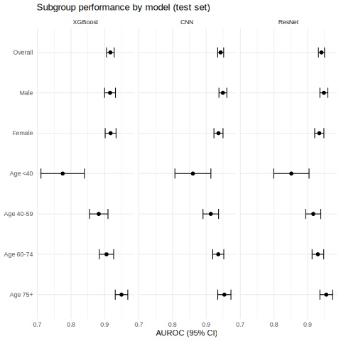
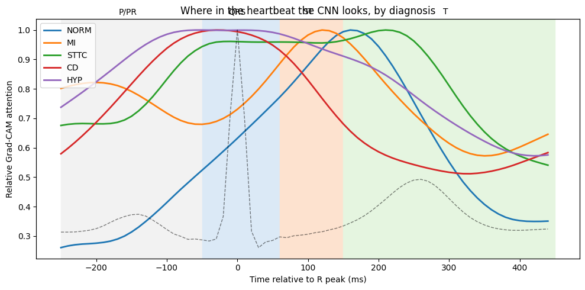
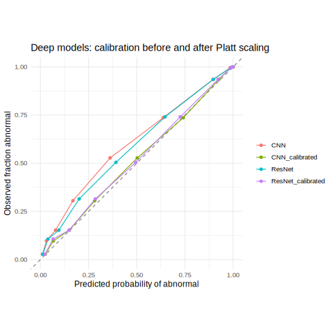
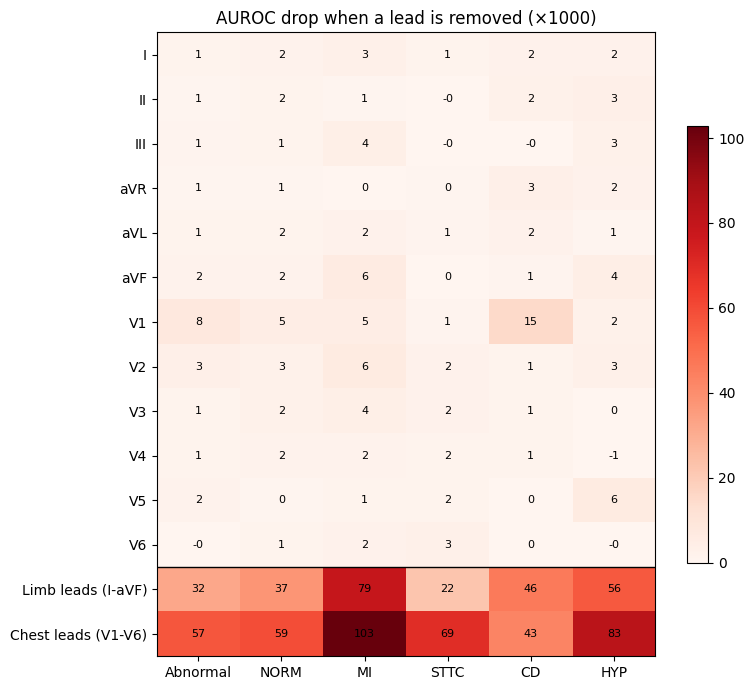
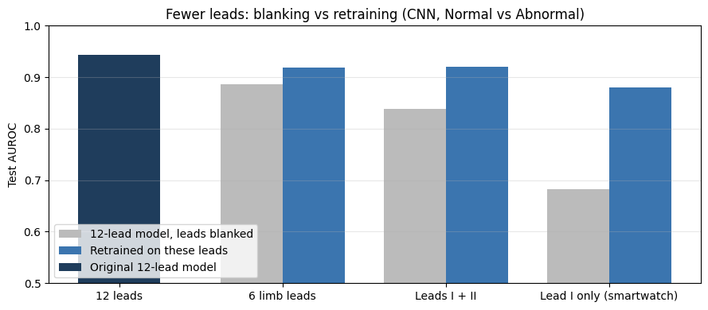
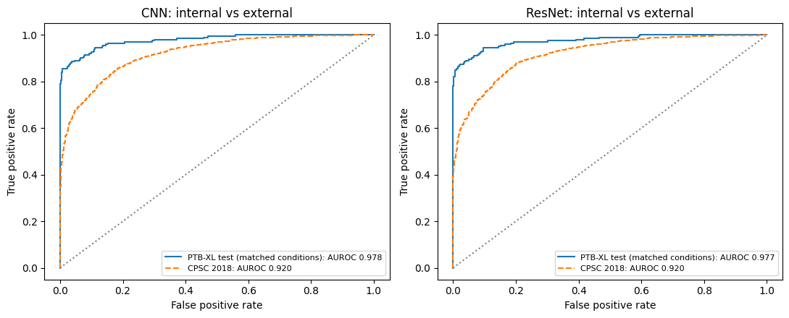

# Interpretable Deep Learning for 12-Lead ECG Abnormality Detection

A reproducible benchmark of handcrafted-feature and deep-learning models for detecting cardiac abnormalities
from 12-lead ECGs, with rigorous statistical evaluation in R, subgroup (fairness) analysis, calibration,
interpretability and robustness testing.

**Author:** Midhili Asok
**Data:** [PTB-XL](https://physionet.org/content/ptb-xl/1.0.3/) (21,388 ECGs) · external validation on CPSC 2018
**Stack:** Python (TensorFlow/Keras, scikit-learn, XGBoost, SciPy, NeuroKit2) · R (pROC, ggplot2, dplyr)

> **Not for clinical use.** This is a research and portfolio project. See the [model card](MODEL_CARD.md).

---

## Key results

| Model | Test AUROC, Normal vs Abnormal (95% CI) | Sensitivity | Specificity |
|---|---|---|---|
| Logistic regression (88 handcrafted features) | 0.885 (0.871–0.898) | 0.747 | 0.882 |
| XGBoost (88 handcrafted features) | 0.917 (0.905–0.928) | 0.794 | 0.899 |
| **1D CNN** (5-seed ensemble, 422K parameters) | **0.944 (0.934–0.952)** | 0.819 | **0.918** |
| 1D ResNet (5-seed ensemble, 3.2M parameters) | 0.941 (0.931–0.950) | **0.852** | 0.893 |

PTB-XL test set (fold 10, n = 2,158). Sensitivity and specificity at thresholds chosen on the validation set.

- **Deep models significantly beat the baseline:** CNN vs XGBoost +0.026 AUROC, DeLong p = 1.4 × 10⁻¹¹ (Holm-adjusted).
- **The CNN matches the ResNet with 7.5× fewer parameters** (DeLong p = 0.054).
- **Five-class multi-label task:** macro AUROC 0.933 (CNN and ResNet ensembles) vs 0.907 (XGBoost). The biggest gain is conduction disturbances (0.869 → 0.923).
- **Fairness:** equal performance for men and women under the baseline. A significant **age gap** exists: under-40 AUROC 0.775 (XGBoost) → 0.861 (CNN) vs 0.954 for patients 75+. It is traced to mild conduction findings in young patients and documented as a limitation.
- **Calibration:** the networks underestimated risk; Platt scaling on validation fixed it (slope 1.01, Brier 0.094).
- **Interpretability:** heartbeat-aligned Grad-CAM shows the CNN reads conduction disturbances and hypertrophy from the QRS complex, and infarction and ST/T changes from the ST segment and T wave, matching clinical practice.
- **Robustness:** at a signal-to-noise ratio of 0 dB the CNN still reaches AUROC 0.920. The 0.5–40 Hz filter keeps AUROC at 0.927 under strong baseline wander (0.692 without it).
- **Fewer leads:** a CNN retrained on lead I alone (what a smartwatch records) reaches 0.880, against 0.682 for the 12-lead model with the other leads blanked. Leads I + II match all six limb leads (0.921 vs 0.919), as Einthoven's law predicts.
- **External validation:** on 4,349 ECGs from 11 Chinese hospitals (CPSC 2018), never seen in training, AUROC is **0.920 (0.911–0.928)**, vs 0.978 on matched PTB-XL conditions. Bundle branch blocks transfer almost perfectly (93–100% detected); ST changes do not (under 50%). The under-40 gap reappears (0.870 vs 0.918).

### Robustness and external validation (CNN, Normal vs Abnormal)

| Test | AUROC |
|---|---|
| PTB-XL test, 12 leads (reference) | 0.943 |
| Heavy Gaussian noise (SNR about 0 dB) | 0.920 |
| Strong baseline wander, with / without bandpass filter | 0.927 / 0.692 |
| 6 limb leads: blanked → retrained | 0.886 → 0.919 |
| Leads I + II: blanked → retrained | 0.839 → 0.921 |
| Lead I only: blanked → retrained | 0.682 → 0.880 |
| Matched PTB-XL conditions (1AVB, LBBB, RBBB, ST depression/elevation vs normal) | 0.978 |
| **CPSC 2018, external (same conditions)** | **0.920** |

---

## Project structure

```
ecg-abnormality-detection/
├── notebooks/
│   ├── 01_data_pipeline.ipynb        # load PTB-XL, filter, standardize, patient-safe splits, augmentation
│   ├── 02_baseline.ipynb             # 88 clinical features; logistic regression and XGBoost
│   ├── 03_deep_models.ipynb          # 1D CNN and 1D ResNet, 2 tasks × 5 seeds, Platt scaling
│   ├── 04_stats_analysis.ipynb       # R analysis run inside Colab (same code as R/statistical_analysis.Rmd)
│   ├── 05_interpretability.ipynb     # Grad-CAM, lead ablation, error analysis
│   └── 06_robustness.ipynb           # noise, reduced leads, external validation (CPSC 2018)
├── src/
│   ├── data.py                       # data loading and tf.data pipeline with augmentation
│   └── models.py                     # CNN and ResNet architectures
├── R/
│   └── statistical_analysis.Rmd      # bootstrap CIs, DeLong, McNemar, subgroups, calibration
├── results/
│   ├── figures/                      # all figures used in this README
│   └── *.csv                         # metrics and test-set predictions
├── MODEL_CARD.md
├── requirements.txt
└── README.md
```

---

## Approach

### 1. Data pipeline
- PTB-XL v1.0.3: 10-second, 12-lead ECGs at 100 Hz, labelled by cardiologists into five diagnostic superclasses: normal (NORM), myocardial infarction (MI), ST/T change (STTC), conduction disturbance (CD) and hypertrophy (HYP).
- **Tasks:** (A) Normal vs Abnormal; (B) 5-class multi-label.
- **Preprocessing:** zero-phase 0.5–40 Hz Butterworth bandpass filter, then per-lead standardization with training-set statistics only.
- **Splits:** the official stratified folds (1–8 train, 9 validation, 10 test), with zero patient overlap verified in code.
- **Augmentation (training only):** amplitude scaling, Gaussian noise, time shifts and random lead dropout.

### 2. Baseline
88 interpretable features per ECG: heart rate and variability, plus R, S, ST and T amplitudes from a median beat per lead. Models are logistic regression and XGBoost with early stopping.

### 3. Deep models
- **Architectures:** a 1D CNN (5 convolution blocks) and a 1D ResNet (7 residual blocks).
- **Training:** AdamW with cosine learning-rate decay, early stopping on validation AUROC, and **5 seeds per model** (reported as mean ± SD and as a 5-seed ensemble).
- **Calibration:** Platt scaling fitted on the validation set.

### 4. Statistical evaluation (R)
- Bootstrap 95% CIs (2,000 resamples).
- Paired DeLong tests with Holm correction, and McNemar's test.
- Subgroup AUROCs by sex and age band, with forest plots.
- Calibration: Brier score, calibration slope and intercept, and reliability curves.

### 5. Interpretability and error analysis
- 1D Grad-CAM, averaged over 5 seeds, plus heartbeat-aligned attention profiles.
- Lead ablation.
- Error rates by recording quality, miss rate per diagnostic code, and a mixed-label sensitivity analysis.

### 6. Robustness and external validation
- Gaussian noise at 8 levels and baseline wander at 5 amplitudes, with and without the bandpass filter.
- Reduced lead sets (6 limb leads, leads I + II, and lead I only), both by blanking leads in the 12-lead model and by retraining the CNN on those leads (3 seeds each).
- External validation on CPSC 2018 without retraining: each record resampled from 500 to 100 Hz and standardized with PTB-XL statistics; SNOMED-CT codes mapped to our labels, with rhythm-only diagnoses excluded; compared against a matched PTB-XL subset with the same conditions.

---

## Figures

| | |
|---|---|
|  |  |
| Subgroup AUROC by sex and age | Where in the heartbeat the CNN looks, by diagnosis |
|  |  |
| Calibration before and after Platt scaling | AUROC drop when leads are removed |
|  |  |
| Fewer leads: blanking vs retraining | Internal vs external ROC curves (CPSC 2018) |

---

## Reproducing the results

1. Download [PTB-XL v1.0.3](https://physionet.org/content/ptb-xl/1.0.3/) (the zip, about 2 GB) to Google Drive.
2. Copy `src/` to `MyDrive/ecg-project/src/`.
3. Open notebooks 01–05 in Google Colab (T4 GPU for 03 and 05) and run them in order. Every notebook reads its inputs from, and writes its outputs to, `MyDrive/ecg-project/`.
4. The R analysis can be run either inside `04_stats_analysis.ipynb` or locally: knit `R/statistical_analysis.Rmd` in RStudio after setting `results_dir` and `metadata_csv` in its header.
5. Notebook 06 runs on Kaggle (GPU T4, Internet on). Add the dataset *China Physiological Signal Challenge in 2018* (physionet) as input, and paste link-shared Google Drive folders for `data_processed` and `models` into Step 0.

Runtime on a free Colab T4: about 2 to 3 hours for all 20 deep-model training runs. All results use fixed seeds; GPU non-determinism can cause tiny differences between runs.

---

## Limitations

- **Single training source.** All models are trained on PTB-XL, recorded in Germany between 1989 and 1996. External validation covers only 5 conditions (no MI or hypertrophy in CPSC 2018).
- **ST changes transfer poorly.** On CPSC 2018 only 48% of ST depressions and 45% of ST elevations are detected, and the best threshold falls from 0.46 to 0.23. A new site would need local recalibration.
- **Age gap.** About half of abnormal ECGs in patients under 40 are still missed (CNN sensitivity 0.485 vs 0.838 for 40 and over). This is a real limitation, not a labelling artefact.
- **Clinically important misses.** Anterior MI (29% missed) and inferior MI (19%) are the most important missed diagnoses.
- **Grad-CAM resolution.** It works at 80 ms resolution and gives one map for all leads.
- **Clinical use.** This is not a regulated medical device and must not be used for clinical decisions.

---

## References

- Wagner P, Strodthoff N, Bousseljot R-D, et al. PTB-XL, a large publicly available electrocardiography dataset. *Scientific Data* 7, 154 (2020).
- Goldberger AL, et al. PhysioBank, PhysioToolkit, and PhysioNet. *Circulation* 101(23), e215–e220 (2000).
- Liu F, et al. An open access database for evaluating the algorithms of electrocardiogram rhythm and morphology abnormality detection. *Journal of Medical Imaging and Health Informatics* 8(7), 1368–1373 (2018).
- Perez Alday EA, et al. Classification of 12-lead ECGs: the PhysioNet/Computing in Cardiology Challenge 2020. *Physiological Measurement* 41(12), 124003 (2020).
- DeLong ER, DeLong DM, Clarke-Pearson DL. Comparing the areas under two or more correlated receiver operating characteristic curves. *Biometrics* 44(3), 837–845 (1988).
- Selvaraju RR, et al. Grad-CAM: visual explanations from deep networks via gradient-based localization. *ICCV* (2017).
