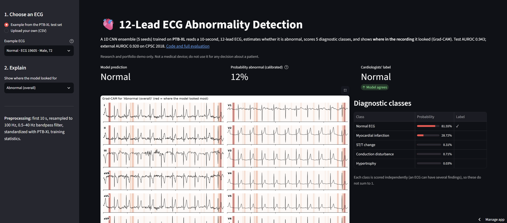

# Interpretable Deep Learning for 12-Lead ECG Abnormality Detection

[](https://ecg-abnormality-detection.streamlit.app)


Can a deep network read a 12-lead ECG better than a model built on the features cardiologists measure, and can it be trusted? This project answers that question with more than a single accuracy number. It trains and compares four models on **21,388 ECGs** labelled by cardiologists, tests every difference statistically in R, checks fairness across age and sex, calibrates the probabilities, explains each prediction with Grad-CAM, stress-tests the model with noise and missing leads, and validates it on **4,349 ECGs from 11 hospitals in China** it never saw during training.

**Try it:** the **[live demo](https://ecg-abnormality-detection.streamlit.app)** lets you pick an ECG (or upload your own), see the model's prediction next to the cardiologists' diagnosis, and see where in the recording the model looked.



---

## Highlights

- **Accurate:** a compact 1D CNN reaches **AUROC 0.944** (95% CI 0.934–0.952) for normal vs abnormal ECGs, significantly better than XGBoost on 88 handcrafted clinical features (0.917, DeLong p = 1.4 × 10⁻¹¹). It matches a ResNet with 7.5× more parameters.
- **Explainable:** Grad-CAM shows the CNN finds conduction disturbances and hypertrophy in the QRS complex, and infarction and ST/T changes in the ST segment and T wave, the same places a cardiologist looks.
- **Robust:** performance barely moves under heavy noise (AUROC 0.920 at a signal-to-noise ratio of 0 dB). Retrained on lead I alone, the signal a smartwatch records, it still reaches 0.880.
- **Externally validated:** AUROC **0.920** on CPSC 2018, a dataset from another country, recorded on different devices.
- **Honest about its limits:** it is weaker in patients under 40 (AUROC 0.861), and that gap appears again at the external hospitals. ST changes transfer poorly between sites. Both are measured, explained and documented in the [model card](MODEL_CARD.md).

---

## Results

### Normal vs abnormal ECG (PTB-XL test set, n = 2,158)

| Model | AUROC (95% CI) | Sensitivity | Specificity |
|---|---|---|---|
| Logistic regression (88 handcrafted features) | 0.885 (0.871–0.898) | 0.747 | 0.882 |
| XGBoost (88 handcrafted features) | 0.917 (0.905–0.928) | 0.794 | 0.899 |
| **1D CNN** (5-seed ensemble, 422K parameters) | **0.944 (0.934–0.952)** | 0.819 | **0.918** |
| 1D ResNet (5-seed ensemble, 3.2M parameters) | 0.941 (0.931–0.950) | **0.852** | 0.893 |

Confidence intervals from 2,000 bootstrap resamples. Sensitivity and specificity at thresholds chosen on the validation set, never on test data.

### What the evaluation found

- **Five diagnostic classes:** for the multi-label task (normal, infarction, ST/T change, conduction disturbance, hypertrophy), the CNN and ResNet ensembles reach a macro AUROC of 0.933, against 0.907 for XGBoost. The largest gain is on conduction disturbances (0.869 → 0.923).
- **Fairness:** performance is similar for men (0.950) and women (0.937). Across age, AUROC rises from 0.861 under 40 to 0.954 at 75 and over. The deep model narrows this gap compared with XGBoost (0.775 under 40), but does not close it.
- **Calibration:** the raw networks underestimated risk. Platt scaling, fitted on the validation set, corrected this (calibration slope 1.01, Brier score 0.094).
- **Error analysis:** missed cases are mostly mild or non-specific findings, such as non-specific conduction delay (41% missed) and incomplete right bundle branch block (18%). Clear-cut diagnoses such as complete bundle branch blocks were never missed in the test set.

### Robustness and external validation (CNN)

| Test | AUROC |
|---|---|
| PTB-XL test, 12 leads (reference) | 0.943 |
| Heavy Gaussian noise (SNR about 0 dB) | 0.920 |
| Strong baseline wander, with / without the bandpass filter | 0.927 / 0.692 |
| 6 limb leads: 12-lead model with leads blanked → model retrained on 6 leads | 0.886 → 0.919 |
| Leads I + II: blanked → retrained | 0.839 → 0.921 |
| Lead I only (smartwatch): blanked → retrained | 0.682 → 0.880 |
| PTB-XL, matched conditions (AV block, bundle branch blocks, ST changes vs normal) | 0.978 |
| **CPSC 2018, external hospitals (same conditions)** | **0.920** |

- **Leads I + II carry all the limb-lead information:** a model trained on just these two matches one trained on all six limb leads. This is what Einthoven's law predicts, since the other four limb leads are computed from I and II.
- **The external drop depends on the condition:** bundle branch blocks are detected 93–100% of the time at the Chinese hospitals, while ST depression and elevation fall below 50%. The best decision threshold also shifts (0.46 → 0.23), so a new hospital would need to recalibrate locally.

---

## Figures

| | |
|---|---|
|  |  |
| Where in the heartbeat the CNN looks, by diagnosis | AUROC by sex and age group, all four models |
|  |  |
| Calibration before and after Platt scaling | AUROC drop when individual leads are removed |
|  |  |
| Fewer leads: blanking vs retraining | Internal vs external ROC curves (CPSC 2018) |

---

## Methods

**Data.** [PTB-XL v1.0.3](https://physionet.org/content/ptb-xl/1.0.3/): 21,388 ten-second, 12-lead ECGs at 100 Hz from about 18,900 patients, each labelled by cardiologists. Two tasks: (A) normal vs abnormal, where "normal" means no abnormal diagnostic class, and (B) five-class multi-label diagnosis. The official stratified folds are used (8 for training, 1 for validation, 1 for testing), with no patient in more than one split.

**Preprocessing.** A zero-phase 0.5–40 Hz Butterworth bandpass filter removes baseline drift and high-frequency noise. Each lead is then standardized with statistics from the training set only, to avoid information leaking from test data. Training uses augmentation: amplitude scaling, Gaussian noise, time shifts and random lead dropout.

**Baselines.** 88 interpretable features per ECG (heart rate and its variability, plus R, S, ST and T-wave amplitudes from a median beat in each lead), modelled with logistic regression and XGBoost.

**Deep models.** A 1D CNN (5 convolution blocks) and a 1D ResNet (7 residual blocks), trained with AdamW, cosine learning-rate decay and early stopping on validation AUROC. Each model is trained with 5 random seeds, and results are reported both as mean ± SD and as a 5-seed ensemble.

**Statistical evaluation (R).** Bootstrap confidence intervals, paired DeLong tests with Holm correction, McNemar's test, subgroup analysis by sex and age with forest plots, and calibration analysis (Brier score, slope, intercept and reliability curves).

**Interpretability.** 1D Grad-CAM averaged over 5 seeds and aligned to each heartbeat, lead ablation, error analysis by diagnostic code and recording quality, and a sensitivity analysis for ECGs labelled with both normal and abnormal findings.

**Robustness and external validation.** Synthetic noise and baseline wander; reduced lead sets, both by blanking leads and by retraining; and external testing on [CPSC 2018](http://2018.icbeb.org/Challenge.html), resampled from 500 to 100 Hz and standardized with PTB-XL statistics. CPSC diagnoses (SNOMED-CT codes) were mapped to the PTB-XL classes, and rhythm-only diagnoses were excluded, because the labels in this project cover morphology, not rhythm.

---

## Repository structure

```
ecg-abnormality-detection/
├── notebooks/
│   ├── 01_data_pipeline.ipynb        # loading, filtering, standardization, patient-safe splits
│   ├── 02_baseline.ipynb             # 88 clinical features; logistic regression and XGBoost
│   ├── 03_deep_models.ipynb          # 1D CNN and ResNet, 2 tasks × 5 seeds, calibration
│   ├── 04_stats_analysis.ipynb       # statistical analysis in R (DeLong, bootstrap, subgroups)
│   ├── 05_interpretability.ipynb     # Grad-CAM, lead ablation, error analysis
│   ├── 06_robustness.ipynb           # noise, reduced leads, external validation on CPSC 2018
│   └── 07_demo_assets.ipynb          # exports model weights and example ECGs for the demo
├── app/
│   ├── streamlit_app.py              # interactive demo: prediction, class probabilities, Grad-CAM
│   └── assets/                       # model weights, configuration and 20 example ECGs
├── src/
│   ├── data.py                       # data loading and augmentation pipeline
│   └── models.py                     # CNN and ResNet architectures
├── R/
│   └── statistical_analysis.Rmd      # the full statistical analysis as an R Markdown report
├── results/
│   ├── figures/                      # all figures
│   └── *.csv                         # metrics, statistical tests and test-set predictions
├── MODEL_CARD.md                     # intended use, performance by subgroup, known failure modes
└── requirements.txt
```

---

## Running the code

The notebooks run in order on Google Colab (GPU for notebooks 03, 05 and 06) after downloading [PTB-XL](https://physionet.org/content/ptb-xl/1.0.3/) from PhysioNet. Notebook 06 was run on Kaggle, which hosts CPSC 2018 as a dataset. Training all 20 deep models takes about 2–3 hours on a T4 GPU. The R analysis can also be run on its own by knitting `R/statistical_analysis.Rmd`.

To run the demo locally:

```bash
pip install -r app/requirements.txt
streamlit run app/streamlit_app.py
```

---

## Limitations

- **One training source.** All models were trained on PTB-XL, recorded in Germany between 1989 and 1996. External validation covered only five conditions, because CPSC 2018 has no infarction or hypertrophy labels.
- **Younger patients.** About half of abnormal ECGs in patients under 40 are missed (sensitivity 0.485, against 0.838 for 40 and over). This is a genuine weakness, not a labelling artefact, and it appears at the external hospitals too.
- **ST changes across hospitals.** Fewer than half of ST depressions and elevations were detected in CPSC 2018; in matched PTB-XL data, 87% of ST depressions were detected.
- **Important misses.** Anterior (29% missed) and inferior (19%) infarctions are the most clinically important errors.
- **Grad-CAM resolution.** Explanations work at 80 ms resolution and give one time map for all 12 leads, not a separate map per lead.
- **Not a medical device.** This is a research project and must not be used for decisions about patients.

---

## Author

**Midhili Asok** · [GitHub](https://github.com/Midhili2003)

Released under the [MIT License](LICENSE). PTB-XL and CPSC 2018 are available from PhysioNet under their own licenses.

## References

- Wagner P, Strodthoff N, Bousseljot R-D, et al. PTB-XL, a large publicly available electrocardiography dataset. *Scientific Data* 7, 154 (2020).
- Goldberger AL, et al. PhysioBank, PhysioToolkit, and PhysioNet. *Circulation* 101(23), e215–e220 (2000).
- Liu F, et al. An open access database for evaluating the algorithms of electrocardiogram rhythm and morphology abnormality detection. *Journal of Medical Imaging and Health Informatics* 8(7), 1368–1373 (2018).
- Perez Alday EA, et al. Classification of 12-lead ECGs: the PhysioNet/Computing in Cardiology Challenge 2020. *Physiological Measurement* 41(12), 124003 (2020).
- DeLong ER, DeLong DM, Clarke-Pearson DL. Comparing the areas under two or more correlated receiver operating characteristic curves. *Biometrics* 44(3), 837–845 (1988).
- Selvaraju RR, et al. Grad-CAM: visual explanations from deep networks via gradient-based localization. *ICCV* (2017).
